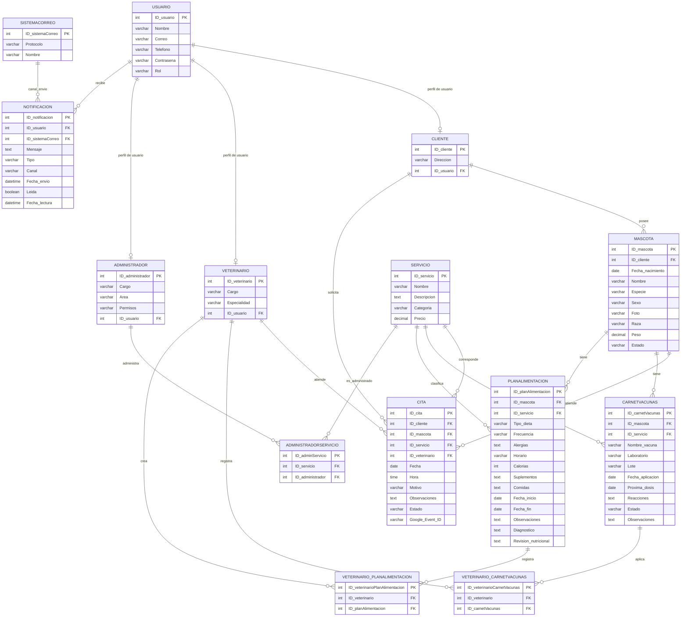

# PETCARD — Diagramas de análisis y diseño

> Documento elaborado a partir de los requerimientos funcionales de PETCARD y del esquema `databaase/percard.sql`. Se consideran exactamente tres roles del sistema: **Usuario** (cliente/dueño de mascota), **Veterinario** y **Administrador**. En la base de datos el rol Usuario aparece como `cliente`.

## 1. Alcance funcional

- El **Usuario** puede registrarse e iniciar sesión, administrar su perfil y sus mascotas, consultar carnet de vacunas, planes de alimentación e historial, solicitar o cancelar citas y consultar notificaciones.
- El **Veterinario** inicia sesión, consulta las citas y fichas de mascotas y registra la atención, vacunas y planes de alimentación asociados a ellas.
- El **Administrador** inicia sesión y gestiona usuarios, mascotas, servicios, citas, vacunas y planes; también consulta la información general del sistema y administra notificaciones.
- El sistema mantiene el catálogo de servicios, registra citas y envía notificaciones relacionadas con eventos importantes.

## 2. Diagrama de casos de uso

```mermaid
flowchart LR
    U[Usuario]
    V[Veterinario]
    A[Administrador]
    subgraph S[PETCARD]
      UC1((Registrarse / iniciar sesión))
      UC2((Gestionar perfil))
      UC3((Gestionar mascotas propias))
      UC4((Consultar ficha e historial de mascota))
      UC5((Consultar carnet de vacunas))
      UC6((Consultar plan de alimentación))
      UC7((Solicitar cita))
      UC8((Cancelar cita propia))
      UC9((Consultar notificaciones))
      VC1((Consultar agenda y citas asignadas))
      VC2((Consultar ficha de mascota))
      VC3((Registrar atención / vacuna))
      VC4((Crear o actualizar plan de alimentación))
      AC1((Gestionar usuarios y roles))
      AC2((Gestionar mascotas))
      AC3((Gestionar catálogo de servicios))
      AC4((Gestionar citas))
      AC5((Gestionar carnet de vacunas))
      AC6((Gestionar planes de alimentación))
      AC7((Gestionar notificaciones))
      AC8((Consultar información general))
    end
    U --- UC1
    U --- UC2
    U --- UC3
    U --- UC4
    U --- UC5
    U --- UC6
    U --- UC7
    U --- UC8
    U --- UC9
    V --- UC1
    V --- VC1
    V --- VC2
    V --- VC3
    V --- VC4
    A --- UC1
    A --- AC1
    A --- AC2
    A --- AC3
    A --- AC4
    A --- AC5
    A --- AC6
    A --- AC7
    A --- AC8
```

## 3. Modelo entidad–relación

Las cardinalidades reflejan las claves foráneas definidas en el esquema SQL. Las tablas de asociación representan las relaciones que el diseño implementado guarda como muchos a muchos.

## 4. Modelo relacional

Notación: `PK` = clave primaria; `FK` = clave foránea; `UQ` = valor único. Se enumeran las tablas y referencias del esquema SQL existente.

- **USUARIO** (`ID_usuario` PK, Nombre, Correo, Telefono, Contrasena, Rol)
- **CLIENTE** (`ID_cliente` PK, Direccion, `ID_usuario` FK → USUARIO.ID_usuario)
- **VETERINARIO** (`ID_veterinario` PK, Cargo, Especialidad, `ID_usuario` FK → USUARIO.ID_usuario)
- **ADMINISTRADOR** (`ID_administrador` PK, Cargo, Area, Permisos, `ID_usuario` FK → USUARIO.ID_usuario)
- **MASCOTA** (`ID_mascota` PK, `ID_cliente` FK → CLIENTE.ID_cliente, Fecha_nacimiento, Nombre, Especie, Sexo, Foto, Raza, Peso, Estado)
- **SERVICIO** (`ID_servicio` PK, Nombre, Descripcion, Categoria, Precio)
- **CITA** (`ID_cita` PK, `ID_cliente` FK → CLIENTE.ID_cliente, `ID_mascota` FK → MASCOTA.ID_mascota, `ID_servicio` FK → SERVICIO.ID_servicio, `ID_veterinario` FK → VETERINARIO.ID_veterinario, Fecha, Hora, Motivo, Observaciones, Estado, Google_Event_ID)
- **CARNETVACUNAS** (`ID_carnetVacunas` PK, `ID_mascota` FK → MASCOTA.ID_mascota, `ID_servicio` FK → SERVICIO.ID_servicio, Nombre_vacuna, Laboratorio, Lote, Fecha_aplicacion, Proxima_dosis, Reacciones, Estado, Observaciones)
- **PLANALIMENTACION** (`ID_planAlimentacion` PK, `ID_mascota` FK → MASCOTA.ID_mascota, `ID_servicio` FK → SERVICIO.ID_servicio, Tipo_dieta, Frecuencia, Alergias, Horario, Calorias, Suplementos, Comidas, Fecha_inicio, Fecha_fin, Observaciones, Diagnostico, Revision_nutricional)
- **NOTIFICACION** (`ID_notificacion` PK, `ID_usuario` FK → USUARIO.ID_usuario, `ID_sistemaCorreo` FK → SISTEMACORREO.ID_sistemaCorreo, Mensaje, Tipo, Canal, Fecha_envio, Leida, Fecha_lectura)
- **SISTEMACORREO** (`ID_sistemaCorreo` PK, Protocolo, Nombre)
- **ADMINISTRADORSERVICIO** (`ID_adminServicio` PK, `ID_servicio` FK → SERVICIO.ID_servicio, `ID_administrador` FK → ADMINISTRADOR.ID_administrador)
- **VETERINARIO_CARNETVACUNAS** (`ID_veterinarioCarnetVacunas` PK, `ID_veterinario` FK → VETERINARIO.ID_veterinario, `ID_carnetVacunas` FK → CARNETVACUNAS.ID_carnetVacunas)
- **VETERINARIO_PLANALIMENTACION** (`ID_veterinarioPlanAlimentacion` PK, `ID_veterinario` FK → VETERINARIO.ID_veterinario, `ID_planAlimentacion` FK → PLANALIMENTACION.ID_planAlimentacion)

## 5. Notas de interpretación

1. En los diagramas se usa **Usuario** para el dueño/cliente, como pediste; en el SQL, ese tipo de cuenta se identifica con `usuario.Rol = 'cliente'` y tiene perfil en `cliente`.
2. Los subtipos `CLIENTE`, `VETERINARIO` y `ADMINISTRADOR` almacenan datos propios de cada rol, vinculados a `USUARIO`.
3. Las asociaciones `ADMINISTRADORSERVICIO`, `VETERINARIO_CARNETVACUNAS` y `VETERINARIO_PLANALIMENTACION` están dibujadas como entidades asociativas porque existen como tablas en la base actual.
4. La documentación de propuesta menciona adjuntos clínicos e historial general de servicios. No se incluyeron como entidades independientes porque no aparecen en el esquema SQL consultado; los requerimientos funcionales visibles en el sistema sí quedan representados.
